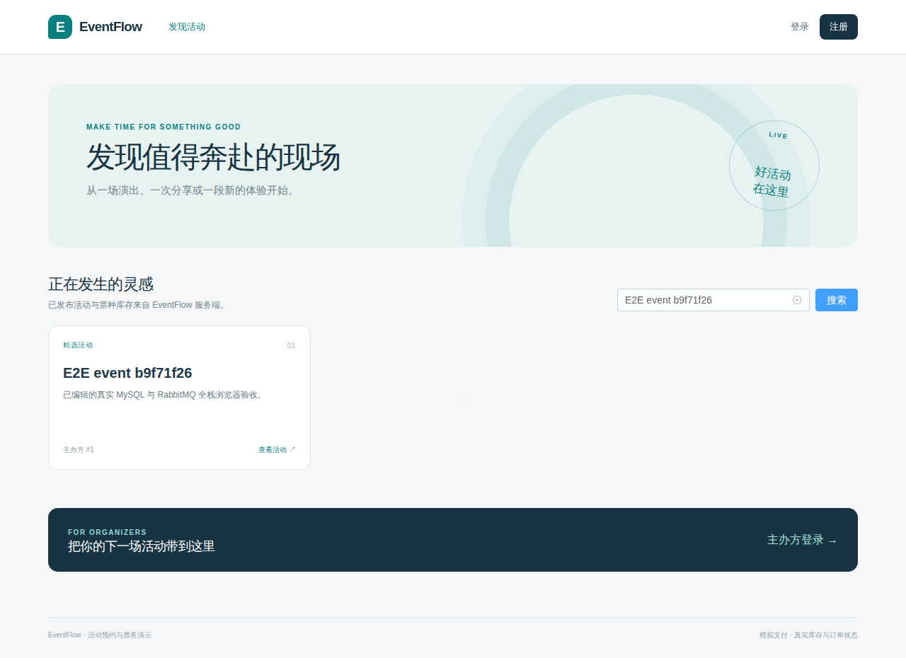
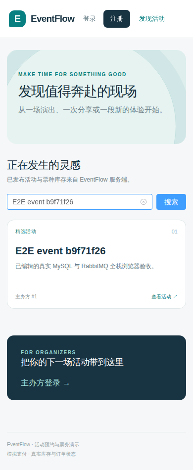

# EventFlow — 活动票务预约与核销平台

Vue 3 / TypeScript / Element Plus 前端真实连接 Java 21 / Spring Boot 4.1.1 / MyBatis 模块化单体。主办方发布活动，用户预约、模拟支付并获得电子票，主办方核销，用户收到异步站内通知。MySQL 保证库存与订单事务，Redis 加速目录和限流，RabbitMQ + Outbox 可靠传递事件。Stage 1–3 已验收（PR #2/#3/#4）；Stage 4 交付等待最终集中审核，不代表已验收。

## 从零运行完整应用

复用已有 **Docker Linux engine + Compose**；全栈构建在容器内完成。宿主开发/测试另需已有 JDK 21、Node 24、pnpm 11，不修改系统默认 Java，也无需安装原生 MySQL、Redis、RabbitMQ。首次构建会获取固定版本镜像、Maven 和前端依赖，需要网络及可用磁盘；不是预先编译的演示假页面。

在仓库根目录运行 PowerShell 7：

```powershell
./infra/New-LocalStackEnv.ps1 -OutputPath .build-cache/stage4.env
# 在本地编辑生成文件，确认 DEV_ORGANIZER_EMAIL / DEV_ORGANIZER_PASSWORD。
# 文件只保存在本机、已忽略；不要提交或在公开日志中展示。
docker compose --env-file .build-cache/stage4.env -p eventflow-full -f infra/docker-compose.full.yml up --build -d --wait --wait-timeout 300
```

打开 **[http://127.0.0.1:8088](http://127.0.0.1:8088)**。五类服务共用隔离网络；仅站点 loopback 端口暴露，API 经 Nginx 同源代理。Spring Boot 启动时 Flyway 自动执行 V1→V2→V3，声明消息拓扑；显式 dev profile 从环境变量创建专属主办方。无公开管理员密码或自助升权入口。重复启动不覆盖原账号密码；初始化文件也拒绝覆盖。

1. 用本地环境文件配置的主办方登录，创建草稿、编辑说明、增加场次/票种、发布。演示核销时把场次设为未来约 30 分钟，满足真实核销窗口。
2. 退出，用公开注册创建 USER，再登录浏览活动、选择一张票预约、查看待付款订单并点击**模拟支付**。
3. 在本人电子票页面生成/轮换核销码和二维码。明文仅在当前页面内存中显示，旧码立即失效；不要把码放进公开截图或日志。
4. 切换所属主办方，手动粘贴当前码核销；切回 USER 刷新确认 USED，并查看稍后到达的支付通知。

JWT 只存内存，页面刷新需重新登录；幂等键重试和会话边界见 [前端说明](frontend/README.md)。显示库存是查询时快照，预约最终由 MySQL 条件更新裁决。支付为状态演示，不处理真实资金。

```powershell
# 安全停止本项目，保留数据卷。下次用相同项目名和环境文件启动。
docker compose --env-file .build-cache/stage4.env -p eventflow-full -f infra/docker-compose.full.yml stop
```

完整端口、密码、构建和隔离说明：[infra/README.md](infra/README.md)。持久卷受 Compose 项目名管理，独立于 Stage 3 开发卷；不操作宿主 MySQL 5.7/3306、原生 Redis 或其他项目，不删除卷。备份/删除数据需要明确单独安排，停止容器不是清空数据库。

## 真实应用与验证入口

下面截图来自真实浏览器连接完整 Compose 的公开活动页，未包含凭据或票码；不是渲染示意图。





| 入口 | 可复现内容 |
|---|---|
| [前端](frontend/README.md) | 类型、lint、格式、单元测试、构建与身份/幂等设计 |
| [E2E](e2e/README.md) | 干净项目中真实浏览器“发布→预约→支付→轮换→核销→通知” |
| [性能实验](benchmarks/README.md) | 隔离数据、冷/热详情读取、p50/p95、原始样本和环境 |
| [Stage 4 交接](docs/handoffs/stage-4.md) | 实测计数、CI、持久化/兼容性、风险与完整证据矩阵 |
| [OpenAPI](docs/openapi.yaml) / [API 契约](docs/02-domain-and-api-contract.md) | 真实字段、角色、归属、状态与错误 |
| [学习总览](docs/learning/00-project-overview.md) | 架构图、源码地图、10 分钟学习演示 |
| [Java 调用链](docs/learning/01-java-spring-code-tour.md) / [并发](docs/learning/02-orders-inventory-concurrency.md) / [中间件](docs/learning/03-redis-rabbitmq-reliability.md) | 从 FastAPI 经验切入 Java、事务与 SQL |
| [面试问答](docs/learning/04-interview-qna.md) / [简历与演示](docs/learning/05-resume-and-demo.md) | 有源码依据的 22 题和证据约束的项目介绍 |

PR 自动执行 [后端 CI](.github/workflows/backend-ci.yml) 与 [前端/全栈 CI](.github/workflows/full-stack-ci.yml)。真实中间件测试不自动 skip；最终运行链接和具体结果见交接报告。单机 Compose 没有生产 TLS、集群 HA、真实支付或未经实验的吞吐承诺。

## 宿主开发模式与历史后端说明

## 环境与数据隔离

复用本机已有 JDK 21.0.9、Maven 3.8.6，无需重新安装。默认 Java 17 不改动；下列命令只改变当前 PowerShell 7+ 会话。Docker Desktop 需运行 Linux engine。开发容器使用固定 tag/digest、项目 named volume 和 loopback 端口：MySQL 8.4.11 为 `3307:3306`、Redis 8.4.7 为 `16379:6379`、RabbitMQ 4.3.6 为 `5673:5672`（管理页 `15673:15672`）。不要修改或停止本机 MySQL 5.7/3306、Redis 或其他项目。集成测试使用自己的动态端口和临时数据。

```powershell
$env:JAVA_HOME = 'D:\JAVA21'
$env:PATH = "$env:JAVA_HOME\bin;$env:PATH"
java -version
mvn -version
docker info
docker compose version
```

首次 wrapper 使用会获取固定的 Maven 3.8.6；依赖解析也需要网络。项目没有要求升级系统 Maven。若需要所有构建缓存留在 D 盘，可为当前会话配置：

```powershell
$buildCache = Join-Path (Get-Location) '.build-cache'
New-Item -ItemType Directory -Path (Join-Path $buildCache 'tmp') -Force | Out-Null
New-Item -ItemType Directory -Path (Join-Path $buildCache 'home') -Force | Out-Null
$env:MAVEN_USER_HOME = Join-Path $buildCache 'maven-user'
$env:TEMP = Join-Path $buildCache 'tmp'
$env:TMP = $env:TEMP
$env:MAVEN_OPTS = "-Duser.home=$buildCache/home -Djava.io.tmpdir=$buildCache/tmp -Dmaven.repo.local=$buildCache/m2"
$env:JAVA_TOOL_OPTIONS = "-Duser.home=$buildCache/home -Djava.io.tmpdir=$buildCache/tmp -Djna.tmpdir=$buildCache/tmp"
```

JAVA_TOOL_OPTIONS 同时覆盖测试子 JVM，避免它们另用系统默认临时目录。仓库路径含空格时，上述 JVM 属性值需要加引号。不要将临时变量写入系统环境、注册表或其他项目配置。

Windows Wrapper 要求 PowerShell 7+（`pwsh`）。Wrapper 固定发行版 SHA-256，保留下载临时文件供用户手动清理，不自动批量删除目录。本机如需沿用已有 Maven 镜像设置，可显式传入 `-gs '现有 Maven 安装目录/conf/settings.xml'`；这只读取设置，不修改它，CI 使用 Maven Central。

## 启动开发库与应用

在仓库根目录复制 `.env.example` 为 **不提交的** `.env`，填写本项目专用数据库、Redis、RabbitMQ 密码和至少 32 字节的随机 JWT 密钥。不要复用现有服务凭据。Compose 加载容器配置；Spring Boot 不会自动读取 `.env`，应用进程所需变量须通过当前终端或 IDE 注入。Redis/RabbitMQ 密码不提供可误用的生产默认值；Compose 对缺少密码直接报错。

```powershell
Copy-Item -LiteralPath '.env.example' -Destination '.env'
# 在本地编辑 .env，替换占位符后启动。不要将密码/密钥粘贴到聊天或提交。
docker compose --env-file .env -f infra/docker-compose.dev.yml up -d --wait --wait-timeout 240
docker compose --env-file .env -f infra/docker-compose.dev.yml ps
```

应用配置：`DB_URL` 默认连接 `127.0.0.1:3307/eventflow`，`DB_USERNAME` 与 `DB_PASSWORD` 对应上述专用用户；若修改 `DB_NAME`，同步设置 `DB_URL`。JDBC 连接统一 UTC。`JWT_SECRET` 缺失或过短会拒绝启动。Flyway 顺序执行 V1→V2→V3；不手工建表或修改已有迁移。缓存连接 `REDIS_HOST/PORT/PASSWORD`，消息连接 `RABBITMQ_HOST/PORT/USERNAME/PASSWORD`，默认端口匹配上述 Compose。

```powershell
# 先通过本地终端/IDE安全注入 DB_USERNAME、DB_PASSWORD、JWT_SECRET。
Set-Location backend
.\mvnw.cmd spring-boot:run '-Dspring-boot.run.profiles=dev'
```

如需演示主办方，仅在显式 `dev` profile 设置 `DEV_ORGANIZER_EMAIL` / `DEV_ORGANIZER_PASSWORD`。初始化只新建专用账户，不会把已有公开注册账户升权；不设这两项则不创建演示账户。生产 profile 不启用该机制。不存在公开升权 API。

两项必须同时设置。相同邮箱、密码、ACTIVE 状态和恰好 USER+ORGANIZER 的现有账户可原样重复启动；其他已存在账户会使初始化拒绝执行，绝不重设密码或角色。修改演示配置时应取消这两项或另选专用邮箱。

健康检查：`GET http://localhost:8080/actuator/health`；仅公开健康状态，不开放数据库详情、环境或调试端点。退出应用用其终端的 Ctrl+C。开发数据库停止命令：

```powershell
# 从仓库根目录执行；保留本项目 volume 和数据。
docker compose --env-file .env -f infra/docker-compose.dev.yml stop
```

修改容器初始化密码不会自动更改已有 volume 内的账户；不要用删除 volume 的方式操作未知数据，先明确本项目数据的处置方案。

## 构建、测试与 CI

```powershell
Set-Location backend
.\mvnw.cmd -B spotless:check verify
```

测试启动真正的 MySQL 8.4、Redis 和 RabbitMQ（Testcontainers），通过 HTTP/应用入口、真实队列及数据库断言验证。原 Stage 1/2 的 30 项测试独立关闭缓存/限流/消息运行回归，Stage 3 新测试启用真实中间件。Docker 不可用会失败；没有 H2 或自动跳过。无需启动开发 Compose，也不连接现有开发库。仅在修正格式时执行 `.\mvnw.cmd spotless:apply`，然后重跑检查。

GitHub Actions 在 PR 和 main 推送上运行 JDK 21、Spotless 与同一 Maven Wrapper verify。真实 MySQL Testcontainers 会验证 100 库存下由 1000 个不同用户发起的并发下单；CI 同时上传测试报告和并发结果 artifact。CI 未通过时不能将数据库 Gate 视为通过。Stage 1 的已验收证据见 [Stage 1 交接](docs/handoffs/stage-1.md)；Stage 2 的实际测试/CI 结果与风险由 [Stage 2 交接](docs/handoffs/stage-2.md) 记录，不在 README 预报未执行结果。

## Stage 3 配置、闭环与故障演练

应用启动时会重复幂等声明 durable exchange/queue/binding。RabbitMQ 管理页位于 `http://127.0.0.1:15673`，用项目 `.env` 中的专用账户登录；不要对外暴露管理端口。所有密码经环境变量注入，不在命令参数或本文填入真实值。

| Exchange `eventflow.events` 的 route | Queue | 后续路径 |
|---|---|---|
| `order.created` | `eventflow.order-expiry.delay` | 每消息 TTL 到期后 DLX 到 `order.expired` |
| `order.expired` | `eventflow.order-expiry` | 事务检查关闭；拒绝时死信 `dead` |
| `order.paid` / `order.closed` / `notification.retry` | `eventflow.notifications` | 通知事务提交后 ack；拒绝时死信 `dead` |
| `order.expired.retry.delay` | `eventflow.order-expiry.retry` | 队列 TTL 后 DLX 到 `order.expired` |
| `notification.retry.delay` | `eventflow.notifications.retry` | 队列 TTL 后 DLX 到 `notification.retry` |
| `dead` | `eventflow.dead-letter` | 保留观察与人工单事件重驱动 |

| 环境变量 | 默认值 / 用途 |
|---|---|
| `EVENT_CACHE_ENABLED` | true，公开目录 Cache Aside |
| `EVENT_CACHE_LIST_TTL_MS` / `EVENT_CACHE_DETAIL_TTL_MS` / `EVENT_CACHE_TTL_JITTER_MS` | 60000 / 300000 / 15000；仅缓存稳定元数据 |
| `REDIS_CONNECT_TIMEOUT` / `REDIS_COMMAND_TIMEOUT` | 300ms / 300ms；故障时查询回源、限流 fail-open |
| `ORDER_RATE_LIMIT_ENABLED` / `ORDER_RATE_LIMIT` / `ORDER_RATE_LIMIT_WINDOW_MS` | true / 20 / 60000；认证 userId 固定窗口 |
| `MESSAGING_ENABLED` | true；false 只停 MQ 组件，业务事务仍写 Outbox |
| `OUTBOX_PUBLISHER_ENABLED` / `OUTBOX_PUBLISHER_DELAY_MS` / `OUTBOX_PUBLISHER_BATCH_SIZE` | true / 1000 / 50 |
| `OUTBOX_CLAIM_LEASE_MS` / `RABBIT_CONFIRM_TIMEOUT_MS` | 30000 / 5000；lease 须覆盖单次确认窗口 |
| `RABBITMQ_CONNECTION_TIMEOUT` / `RABBITMQ_CHANNEL_RPC_TIMEOUT` | 2s / 2s，限制连接与 channel RPC 等待 |
| `OUTBOX_PUBLISH_BACKOFF_BASE_MS` / `OUTBOX_PUBLISH_BACKOFF_MAX_MS` | 1000 / 300000；持久退避，长期停机后继续恢复 |
| `ORDER_EXPIRY_LISTENER_ENABLED` / `NOTIFICATION_LISTENER_ENABLED` | true / true，可暂停消费者验证兜底 |
| `MESSAGE_CONSUMER_MAX_RETRIES` / `MESSAGE_CONSUMER_RETRY_DELAY_MS` | 3 / 5000，超限进入 DLQ |
| `ORDER_EXPIRY_SCAN_ENABLED` / `ORDER_EXPIRY_SCAN_DELAY_MS` | true / 30000，独立 MySQL 扫描 |
| `ORDER_EXPIRY_RETRY_BASE_MS` / `ORDER_EXPIRY_RETRY_MAX_MS` | 1000 / 300000，毒单持久退避 |

沿用下方订单演示完成一次支付/取消，再查询本人通知。异步通知可能稍晚出现，列表按 id 倒序；令牌只保留在内存变量中。

```powershell
$notifications = Invoke-RestMethod -Uri "$api/me/notifications?page=0&size=20" -Headers $headers -TimeoutSec 10
# 缓存变热后继续下单，再读详情，availableStock 每次仍来自 MySQL。
$detail = Invoke-RestMethod -Uri "$api/events/$($draft.id)" -TimeoutSec 10
```

下面只操作本项目 Compose，停止后仍保留卷。先用专用演示账户创建未来场次和库存，记录订单 ID；不要在生产数据上注入故障。

```powershell
# 从仓库根目录；应用继续运行。
docker compose --env-file .env -f infra/docker-compose.dev.yml stop redis
# 公开活动应继续可查；下单的 Redis 限流 fail-open，MySQL 仍防超卖。
docker compose --env-file .env -f infra/docker-compose.dev.yml start redis

docker compose --env-file .env -f infra/docker-compose.dev.yml stop rabbitmq
# 此时新下单/支付仍提交，outbox_events 保持 PENDING/退避；到期由 DB scanner 关单。
docker compose --env-file .env -f infra/docker-compose.dev.yml start rabbitmq
docker compose --env-file .env -f infra/docker-compose.dev.yml ps
# 恢复后等待 next_attempt_at，观察 Outbox SENT 与本人通知；不要打印 payload。
```

若使用已有命名项目启动，请在所有命令加相同 `-p 项目名`。暂停到期消费者可临时为当前应用进程设置 `ORDER_EXPIRY_LISTENER_ENABLED=false` 并重启应用，保留 `ORDER_EXPIRY_SCAN_ENABLED=true`；只改该进程，不写系统环境。再恢复变量并重启以检验重复/晚到消息。测试中的消费者启停、MQ stop_app/start_app、未路由、Redis 超时及 101 毒单均有可重复自动断言，详见交接矩阵。

只读观察 SQL（通过项目专用数据库连接执行，避免在 CLI 参数中明文给密码）：

```sql
SELECT status, COUNT(*) AS events FROM outbox_events GROUP BY status;
SELECT event_id, aggregate_id, event_type, status, attempts, next_attempt_at,
       lease_until, last_error FROM outbox_events ORDER BY created_at LIMIT 20;
SELECT id, status, expires_at, expiry_retry_at, expiry_retry_attempts
FROM orders WHERE status = 'PENDING_PAYMENT' ORDER BY expiry_retry_at, expires_at LIMIT 101;
```

Poison message 会进入 durable DLQ，在管理页观察积压和 headers，消息正文应仅为事件 UUID。先修复根因，再对**一个已确认的 canonical 事件 ID**进行人工重驱动：将该 Outbox 的 SENT 状态重置为 PENDING，随后由正常 publisher 执行 confirms。DLQ 原始记录保留供排查；不要清空整队列，也不要对 CLAIMED 中的活跃事件重置 lease。

```sql
-- 用管理页/只读 SQL 确认的单个 UUID 替换 :event_id；预先确认根因已修复。
UPDATE outbox_events SET status = 'PENDING', next_attempt_at = UTC_TIMESTAMP(6),
  lease_owner = NULL, lease_until = NULL, published_at = NULL, last_error = NULL
WHERE event_id = :event_id AND status = 'SENT';
```

该重驱动会重新投递同一 eventId，唯一约束防止已成功通知重复。没有对应 canonical Outbox 的伪造消息不应补造业务事件；保留其 DLQ 证据即可。单节点 durable 队列不是磁盘灾难恢复方案，TTL/DLX 也不是精准定时器；MySQL scanner 与 Outbox 保留记录提供应用层恢复边界。

- [ADR 0003：缓存与可靠性设计](docs/decisions/0003-stage-3-reliability.md)
- [Stage 3 关键调用链](docs/learning/stage-3-key-flows.md)
- [Stage 3 验证、CI 与故障证据](docs/handoffs/stage-3.md)

## Stage 2 设计与实现资料

- [Stage 2 任务书和验收标准](docs/08-stage-2-codex-task.md)
- [订单、库存与票据 API 契约](docs/02-domain-and-api-contract.md)
- [ADR 0002：幂等、锁序与票务一致性](docs/decisions/0002-stage-2-order-consistency.md)
- [Stage 2 关键调用链与状态图](docs/learning/stage-2-key-flows.md)
- [Stage 1 已验收交接](docs/handoffs/stage-1.md)
- Stage 2 的实测数据只在 `docs/handoffs/stage-2.md` 填入已观察结果。

## Stage 1 HTTP 示例


以下 PowerShell 7+ 示例使用内存变量接收登录令牌，避免打印令牌；密码变量应由用户在本机安全输入。默认注册仅分配 USER。主办方接口需要显式 dev 初始化的主办方账户登录令牌。

```powershell
$api = 'http://localhost:8080/api/v1'
$registration = @{email='reader@example.test'; password=$localPassword} | ConvertTo-Json
Invoke-RestMethod -Method Post -Uri "$api/auth/register" -ContentType 'application/json' -Body $registration -TimeoutSec 10
$credentials = @{email='reader@example.test'; password=$localPassword} | ConvertTo-Json
$login = Invoke-RestMethod -Method Post -Uri "$api/auth/login" -ContentType 'application/json' -Body $credentials -TimeoutSec 10
$headers = @{Authorization="Bearer $($login.accessToken)"}
Invoke-RestMethod -Uri "$api/auth/me" -Headers $headers -TimeoutSec 10
Invoke-RestMethod -Uri "$api/events?keyword=Java&page=0&size=20" -TimeoutSec 10

# dev profile 的主办方凭据由当前 PowerShell 会话注入；不要输出登录响应或 token。
$organizerCredentials = @{email=$env:DEV_ORGANIZER_EMAIL; password=$env:DEV_ORGANIZER_PASSWORD} | ConvertTo-Json
$organizerLogin = Invoke-RestMethod -Method Post -Uri "$api/auth/login" -ContentType 'application/json' -Body $organizerCredentials -TimeoutSec 10
$organizerHeaders = @{Authorization="Bearer $($organizerLogin.accessToken)"}
$body = @{title='Java Meetup';description='Backend practice'} | ConvertTo-Json
$draft = Invoke-RestMethod -Method Post -Uri "$api/organizer/events" -Headers $organizerHeaders -ContentType 'application/json' -Body $body -TimeoutSec 10
$sessionBody = @{title='Morning';startsAt=[DateTimeOffset]::UtcNow.AddDays(1).ToString('o');endsAt=[DateTimeOffset]::UtcNow.AddDays(1).AddHours(2).ToString('o');location='Room A'} | ConvertTo-Json
$session = Invoke-RestMethod -Method Post -Uri "$api/organizer/events/$($draft.id)/sessions" -Headers $organizerHeaders -ContentType 'application/json' -Body $sessionBody -TimeoutSec 10
$skuBody = @{name='Standard';priceCents=1000;totalStock=20} | ConvertTo-Json
Invoke-RestMethod -Method Post -Uri "$api/organizer/sessions/$($session.id)/ticket-skus" -Headers $organizerHeaders -ContentType 'application/json' -Body $skuBody -TimeoutSec 10
Invoke-RestMethod -Method Post -Uri "$api/organizer/events/$($draft.id)/publish" -Headers $organizerHeaders -TimeoutSec 10
Invoke-RestMethod -Uri "$api/events/$($draft.id)" -TimeoutSec 10
```

S1 路由、输入和状态码的完整定义见 [API 契约](docs/02-domain-and-api-contract.md)。PATCH 只支持草稿的 title/description；列表 page 从 0 开始，size 默认 20、上限 100。时间必须带 UTC/offset，输出为 UTC。金额是整数分，票量非负；发布时必须至少有一场未来场次，每场必须有票种。发布后不再修改。跨主办方资源统一 404；无主办角色 403，未登录 401。错误固定为 `{code,message,requestId,timestamp}`，`X-Request-Id` 对应服务端生成的 requestId。

## Stage 2 下单、模拟支付与核销演示

先按上面的 Stage 1 示例创建活动、添加未来场次与票种并发布；开发主办方种子凭据必须仅在显式 dev profile 中配置。沿用已登录 USER 的 `$headers`，用公开活动详情取得 SKU。请求响应都赋给内存变量；不要打印、复制到聊天或记录核销码。

```powershell
$api = 'http://localhost:8080/api/v1'
$event = Invoke-RestMethod -Uri "$api/events/$($draft.id)" -TimeoutSec 10
$skuId = [long]$event.sessions[0].ticketSkus[0].id

$idempotencyKey = [Guid]::NewGuid().ToString('N')
$orderBody = @{skuId=$skuId; idempotencyKey=$idempotencyKey} | ConvertTo-Json
$order = Invoke-RestMethod -Method Post -Uri "$api/orders" -Headers $headers -ContentType 'application/json' -Body $orderBody -TimeoutSec 10

# 网络超时后也重用同一 key；重放返回原单，不再次占库存。
$replay = Invoke-RestMethod -Method Post -Uri "$api/orders" -Headers $headers -ContentType 'application/json' -Body $orderBody -TimeoutSec 10
if ($replay.id -ne $order.id) { throw 'Idempotent replay returned a different order' }

$paidOrder = Invoke-RestMethod -Method Post -Uri "$api/orders/$($order.id)/pay" -Headers $headers -TimeoutSec 10
$myTickets = Invoke-RestMethod -Uri "$api/me/tickets?page=0&size=20" -Headers $headers -TimeoutSec 10
# 列表只包含当前用户拥有且订单已 PAID 的票据。
$ticketId = [long]$paidOrder.ticket.id

# 明文只在此变量中短暂存在；不要 Write-Output、Format-List 或开启终端 transcript。
$codeResponse = Invoke-RestMethod -Method Post -Uri "$api/me/tickets/$ticketId/checkin-code" -Headers $headers -TimeoutSec 10

# dev organizer 凭据应由当前会话安全注入；此处不回显登录响应或 token。
$organizerCredentials = @{email=$env:DEV_ORGANIZER_EMAIL; password=$env:DEV_ORGANIZER_PASSWORD} | ConvertTo-Json
$organizerLogin = Invoke-RestMethod -Method Post -Uri "$api/auth/login" -ContentType 'application/json' -Body $organizerCredentials -TimeoutSec 10
$organizerHeaders = @{Authorization="Bearer $($organizerLogin.accessToken)"}
$checkInBody = @{checkinCode=$codeResponse.checkinCode} | ConvertTo-Json
$checkInResult = Invoke-RestMethod -Method Post -Uri "$api/organizer/tickets/check-in" -Headers $organizerHeaders -ContentType 'application/json' -Body $checkInBody -TimeoutSec 10
```

首个订单返回 201，完全相同的用户/键/SKU 重放返回 200 与同一个订单；同用户用该键换 SKU 是 409。支付返回订单和 TicketView；核销码只能通过本人票据端点生成或轮换，原文只在响应出现一次。以上代码不会把核销码或 Bearer token 写入终端输出。实际取消/过期扫描、核销拒绝边界与并发情况由 Testcontainers 集成测试覆盖。

用户只能读取和操作本人订单/票据，ADMIN 也不绕过此所有权边界；纯 ORGANIZER 不能下单。ORGANIZER 只能核销自己活动的票，ADMIN 可以跨主办方核销。过期支付返回 409，由后台扫描器关单；关闭订单仍可用原幂等键重放到原单。
## 目录与设计

- `backend/src/main/java/com/eventflow/identity`：注册、登录、账户 DTO 与权限。
- `backend/src/main/java/com/eventflow/event`：活动、场次、票种与公开库存服务；下单通过 InventoryService → InventoryMapper XML。
- `backend/src/main/java/com/eventflow/common`：统一错误、requestId、安全配置与分页响应。
- `backend/src/main/java/com/eventflow/order`、`ticket`：订单/票据 API、事务服务、Mapper 与状态。
- `backend/src/main/java/com/eventflow/messaging`、`notification`：Outbox、确认发布、幂等消费、到期触发与本人通知。
- `backend/src/main/resources/db/migration`：Flyway V1/V2/V3 顺序迁移。
- `backend/src/test`：真实 MySQL 与安全边界测试。
- `infra/docker-compose.dev.yml`：本项目独立开发库。
- [ADR 0001](docs/decisions/0001-stage-1-security-and-persistence.md)：Stage 1 JWT、UTC、迁移与活动发布锁。
- [ADR 0002](docs/decisions/0002-stage-2-order-consistency.md)：Stage 2 幂等、锁序、终态竞争与核销。
- [Stage 2 学习文档](docs/learning/stage-2-key-flows.md)：下单、关闭、支付/关单竞争与核销调用链。
- [项目章程](docs/00-project-charter.md)、[架构规范](docs/01-architecture-and-code-style.md)、[阶段门禁](docs/03-stage-roadmap-and-gates.md)、[Stage 1 任务](docs/04-stage-1-codex-task.md)、[环境复用授权](docs/07-stage-0-review-and-stage-1-authorization.md)、[原始环境预检](docs/handoffs/environment-preflight.md)。

所有主办方修改都在事务中锁定活动父记录，发布再执行带 DRAFT 条件的状态更新；不使用进程内锁模拟数据库一致性。关键词通过绑定参数与 LIKE 字面通配符转义处理，分页在 SQL 层完成。Stage 1/2 的行为契约分别见对应文档；实际构建、测试、CI 与并发测试观察结果以各阶段 handoff 为准，不声明未实测的吞吐或性能提升。
