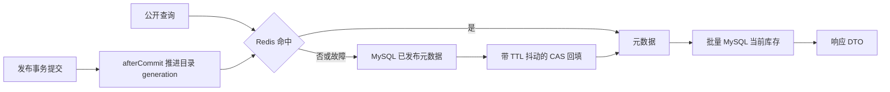
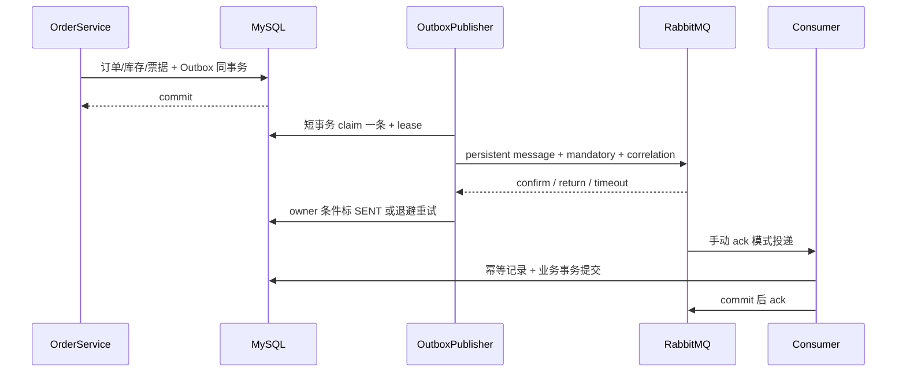
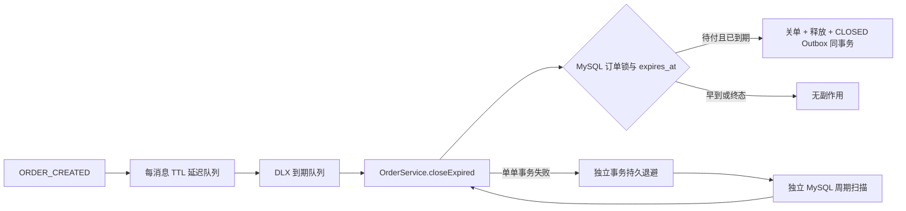

# ADR 0003：Redis 读模型与 RabbitMQ 至少一次处理

状态：Stage 3 实现；实际验证与剩余限制见 [交接报告](../handoffs/stage-3.md)。保留模块化单体、MyBatis 和 MySQL 事务，不引入分布式事务或 Redis 库存锁。

## 缓存只保存稳定元数据

公开目录采用 Cache Aside。列表和详情元数据写入带抖动的 TTL；详情缓存不包含 `availableStock`，每次请求都批量读取 MySQL 当前库存补齐。这个读值也只是查询时的观察值，下单始终经 `InventoryService.reserve` 的锁序与条件 UPDATE 判定，不能凭详情库存承诺售票。

回填前读取 generation，Lua 仅在代数未变化时写入，防止发布后被旧读覆盖。发布只在事务成功后失效；回滚不会让 Redis 呈现发布成功。不存在和草稿详情不缓存：避免为任意不可信 ID 创建海量负键，也避免草稿转发布仍受负 TTL 阻挡。公开查询仍受 API 输入长度/分页限制；这不是完整的匿名流量防护，恶意随机 ID 会回源，应由部署入口承担额外流量限制。

已发布元数据在本阶段不可编辑。Redis 故障时读写均退回 MySQL；失效通知丢失时，旧列表最多保留配置的 TTL 加抖动，可能暂时不展示新发布活动。详情库存不受该窗口影响。缓存命中、未命中、失效、Redis 故障通过 `EventCacheMetrics` 观察，未添加公开调试接口。

## 下单限流

认证及角色校验后，以认证主体 userId 为键执行一个 Lua 脚本，原子增加计数并在首个请求设置过期；固定窗口默认 20 次/60 秒，拒绝返回 `429 RATE_LIMIT_EXCEEDED` 和统一错误结构。请求包括幂等重放也占用限额，防止重复请求绕过流量保护。不同用户的键独立；可配置关闭或提高限额。

Redis 故障采用 fail-open，保证依赖故障不使所有用户无法下单。降级会降低流量防护能力，库存、幂等、支付与核销正确性继续由 MySQL 约束保证。连接和命令超时独立外部化，不能无限阻塞请求。

## 本地事务 Outbox 与可恢复发布

`ORDER_CREATED`、`ORDER_PAID`、`ORDER_CLOSED` 仅在真实状态变化时记录；幂等重放不会新增事件。Outbox 写入失败使原业务事务整体回滚；该事务不等待 MQ 网络操作。MySQL 提交和 MQ 确认之间没有跨系统 ACID。

发布器通过持久 lease 认领事件，网络发送在数据库事务之外；失效 lease 可再次认领。只有 confirm ack 且无 mandatory return 才能标 SENT。宕机发生在发布后、标记前时会重复发送，这是预期的至少一次语义。超时、nack、未路由和连接失败保留记录，采用有上限延迟的持久退避，长期故障恢复后仍能自动发布。日志只包含事件 ID、聚合 ID、异常分类，不打印 payload 或驱动参数。

候选读取不锁范围，认领使用 `WHERE event_id=? AND (PENDING 已到期 OR CLAIMED lease 已过期)` 的原子 UPDATE；受影响一行才取得 owner。并发候选可相同，失败方返回空并在后续批次重查。最初 `FOR UPDATE SKIP LOCKED` 加 OR/排序扫描在默认 RR 下实测出现 secondary-index 死锁，因此改用主键条件认领，避免范围扫描锁与状态索引迁移交叉。标记成功/失败仍同时检查 CLAIMED 与 owner；瞬时认领异常结束本批、下次调度再试，不能假装已发布。

## 消费提交、重试与死信

MQ 只传递事件 ID；消费者读取数据库 canonical Outbox，校验事件类型、聚合及必要 payload。通知在事务内插入唯一 `event_id`，消费去重表以 `(event_id,consumer_name)` 为主键。事务提交后才 ack，提交后 ack 丢失只会重投，不重复生成通知或释放库存。

瞬时业务错误经持久 retry 队列 TTL 回主队列；确认重发成功后才 ack 原消息。重试次数有界，损坏消息和用尽重试进入可观察 DLQ。重发本身不能确认时也进入死信路径，避免无穷即时 requeue。运维需监控 pending/lease/attempts、DLQ 堆积，并在修复原因后人工重驱动；这不是端到端 exactly-once。

## 到期触发与公平补偿

TTL 从订单 `expires_at` 计算；早到、晚到、重复、乱序都必须重新检查 MySQL 当前状态和时间。TTL/DLX 有队头阻塞与调度延迟，不能提供精准到期时刻承诺。消息缺失、MQ 停机或消费者暂停时，独立 DB scanner 仍逐单通过 Spring 代理关单。

扫描每批最多 100 条，同时过滤 `expiry_retry_at <= now`。失败订单由另一个服务的 `REQUIRES_NEW` 事务写退避时间与次数；原关单事务先回滚，后续健康订单可在下一轮推进。默认退避 1 秒开始指数增长，最多 5 分钟。扫描器本身不持有跨批事务，也不通过 `this` 自调用事务方法；如果连退避写入也因 MySQL 故障失败，记录安全异常类型并由后续调度重试。

调度线程池为两个线程，发布和 DB 扫描各占一个任务槽，MQ 网络等待不会占据唯一调度线程而饿死 DB 兜底。RabbitMQ 连接、channel RPC 和 confirm 等待分别设超时；不要把调度池缩为单线程。

## 版本与替代方案

沿用 Java 21、Boot 4.1.1、MyBatis Starter 4.1.0、MySQL 8.4.11、Testcontainers 1.21.4。新增 Boot 管理的 Redis/AMQP Starter 4.1.1，实际解析 Spring Data Redis / Spring AMQP 4.1.1、Lettuce 7.5.2.RELEASE、Rabbit Java Client 5.30.0。

Redis `8.4.7-alpine`、RabbitMQ `4.3.6-management-alpine` 的 tag 通过 [Docker 官方 Redis 清单](https://github.com/docker-library/official-images/blob/master/library/redis) 和 [RabbitMQ 清单](https://github.com/docker-library/official-images/blob/master/library/rabbitmq) 核实，并在 Compose 固定实拉 digest。确认与消费确认语义参见 [RabbitMQ 官方文档](https://www.rabbitmq.com/docs/confirms)，Spring 发布确认参见 [Spring AMQP](https://docs.spring.io/spring-amqp/reference/amqp/template.html)。

不采用 Redis 原子扣减作为订单真值，不在事务里直接发 MQ，不用无限 nack/requeue，不依赖额外延时插件，不把 TTL 当严格定时器。单节点开发 durable queue 的数据安全仍取决于磁盘和 broker 存活；生产多节点复制、监控告警、保留清理策略和吞吐容量评估留待单独授权。
