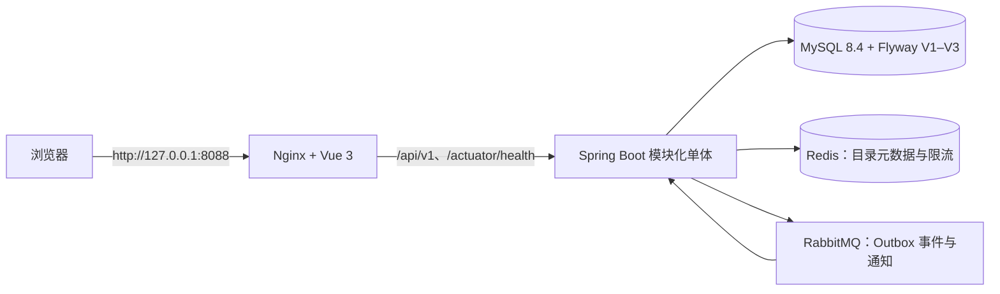

# 00｜项目总览

EventFlow 是一个活动预约与电子票演示系统：主办方发布活动，用户预约一张票并完成模拟支付，系统签发可轮换的核销码，入场时由主办方核销。未付款订单会到期关闭并释放库存。它补充 Python/FastAPI/Agent 经历中的 Java 后端技能，重点是 Spring 分层、MyBatis SQL、MySQL 事务与锁、JWT/RBAC、Redis 和 RabbitMQ 的可验证取舍。

## 先看边界

当前是**模块化单体**：一个 Spring Boot 部署单元按身份、活动、订单、票务、通知和消息划分包。模块之间通过应用服务协作；订单不会直接调用活动模块的 Mapper。当前业务数据真值在 MySQL。Redis 缓存已发布活动元数据并辅助限流，RabbitMQ 传递事务 Outbox 中的事件；它们都不替代 MySQL 的业务判定。

选择单体是为了让本项目的核心事务能留在一个服务和一个数据库里，同时保留清楚的代码边界，降低求职演示和本地复现成本。仓库没有拆成微服务，也没有把库存正确性移到 Redis 或把 MySQL/MQ 包装成分布式事务。

## 完整部署示意

Stage 4 的完整 Compose 部署由浏览器入口和四个内部服务构成；Nginx 提供 Vue 静态文件，并把同源 API/健康检查转发到后端。数据库和消息服务只在 Compose 网络内供后端访问。

完整启动命令、变量模板、持久卷和安全停止方式以 [完整部署说明](../../infra/README.md) 和仓库根目录 [README](../../README.md) 为准。公开站点只绑定回环地址；浏览器通过同源代理访问 `/api/v1`，Compose 内服务用服务名互连。部署图不代表多节点高可用。

## 目录地图

| 路径 | 学习内容 |
|---|---|
| `backend/src/main/java/com/eventflow/identity` | 注册、登录、JWT 服务 |
| `backend/src/main/java/com/eventflow/common/security` | 无状态 Resource Server、角色映射与错误入口 |
| `backend/src/main/java/com/eventflow/event` | 活动、场次、票种、缓存与库存应用边界 |
| `backend/src/main/java/com/eventflow/order` | 幂等预约、订单状态、限流、到期补偿 |
| `backend/src/main/java/com/eventflow/ticket` | 电子票、核销码轮换与一次性核销 |
| `backend/src/main/java/com/eventflow/messaging`、`notification` | Outbox 发布、RabbitMQ 消费、通知去重 |
| `backend/src/main/resources/mapper` | MyBatis XML 显式 SQL |
| `backend/src/main/resources/db/migration` | Flyway V1、V2、V3 增量迁移 |
| `backend/src/test/java/com/eventflow/Stage1IntegrationTest.java` 等 | 通过 Testcontainers 和真实 HTTP/中间件验证不变量 |
| `frontend/src` | Vue 页面、API 类型、身份状态、路由与业务功能 |
| `infra`、`e2e`、`benchmarks` | Compose、真实浏览器验收与可重复性能实验 |
| `docs/decisions`、`docs/handoffs`、`docs/learning` | 设计取舍、阶段证据和源码导读 |

Vue 页面和菜单只帮助导航，不构成授权边界。访问每个受保护 API 时，后端仍验证 JWT、角色和资源归属。

## 10 分钟演示路线

演示前按 README 启动隔离的全栈 Compose；使用环境变量人工配置的 dev ORGANIZER 账号。普通 USER 从公开注册页面创建，系统没有可用的公开管理员口令。不要将 JWT 或核销码截图、粘贴到公开材料。

1. **0:00–1:00** 打开活动列表，搜索并查看公开活动详情、场次、票价和当前可售量。
2. **1:00–2:00** 用人工配置的主办方账号登录，创建草稿、增加未来场次和票种，然后发布；回到公开页面刷新确认活动出现。
3. **2:00–4:00** 登出并用普通用户注册/登录，选择一个 SKU 预约；刷新或重试时沿用同一个幂等键，查看本人待付订单。
4. **4:00–5:00** 点击标注为“模拟支付”的操作，确认订单 PAID 且生成电子票。重新打开本人票据并轮换核销码，说明旧码失效，二维码只呈现这次响应的码。
5. **5:00–7:00** 登出并以活动所属主办方登录，手动粘贴核销码；确认成功后切回用户查看 USED 状态。展示站内通知，说明它由 RabbitMQ 异步生成，所以可能稍后出现。
6. **7:00–10:00** 查看订单/活动 API 错误 requestId 和自动化测试证据；用源码地图解释库存条件更新、Outbox 和数据库兜底扫描。演示中避免声称经过实验的吞吐数字，性能结论只引用 `benchmarks/results/` 的原始文件和说明。

继续学习：先读 [Java/Spring 源码路线](01-java-spring-code-tour.md)，再读 [订单并发](02-orders-inventory-concurrency.md) 与 [Redis/RabbitMQ 可靠性](03-redis-rabbitmq-reliability.md)。
