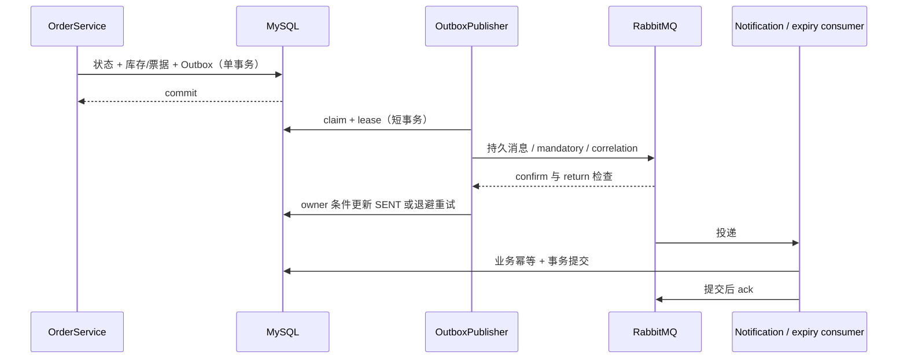

# 03｜Redis、RabbitMQ 与故障恢复

这些中间件是可替换的性能/传递设施。活动和订单真值仍在 MySQL；缓存和消息队列故障会影响新鲜度或完成时间，但不能决定订单是否支付、关闭、释放库存或核销。

## Redis：Cache Aside 与可见边界

`EventService.published/publishedDetail` 经 `RedisPublishedEventCache` 先读，再在未命中时从 EventMapper 取已发布元数据并回填。不存在/草稿不缓存。详情缓存不保存 `availableStock`；每次详情查询都通过 `InventoryMapper.listAvailableStock` 批量查当前 MySQL 库存。这个数仍只是响应时刻的观察，最终扣减走 `InventoryService.reserve` 的事务条件 UPDATE。

缓存失效放在活动发布事务提交之后：`invalidateAfterCommit` 推进 generation，Lua 回填 CAS 避免老读覆盖新一代。Redis 出错时目录读退回 MySQL。失效或发布响应丢失时，列表可能保留默认 60 秒加最多 15 秒抖动的旧元数据；Redis 不可用时流量保护能力也需单独评估。没有对外暴露内部 metrics/debug endpoint。

实现：[RedisPublishedEventCache](../../backend/src/main/java/com/eventflow/event/infrastructure/RedisPublishedEventCache.java)、[EventCacheMetrics](../../backend/src/main/java/com/eventflow/cache/EventCacheMetrics.java)、[Stage3IntegrationTest.cacheAsideUsesLiveMysqlStockInvalidatesAfterCommitAndDoesNotCacheMisses](../../backend/src/test/java/com/eventflow/Stage3IntegrationTest.java)。

## Redis：下单限流 fail-open

`OrderRequestRateLimiter.check` 在 authenticated userId 上执行 Redis Lua 原子计数，默认每 60 秒 20 次，超限返回 `429 RATE_LIMIT_EXCEEDED`。该计数包括幂等重放；不同用户的计数隔离。Redis 暂时不可用时 fail-open 允许请求继续，从而限制服务不可用，但会失去该层流量保护。安全不变量仍由数据库幂等键、库存 SQL 和订单行锁保证。客户端不能把 429 解释为售罄。

真实 Redis 故障与窗口测试：`Stage3IntegrationTest.redisRateLimitIsAtomicPerUserAndCacheAndOrderFallbackRecoverAfterPause`；实现见 [`OrderRequestRateLimiter.java`](../../backend/src/main/java/com/eventflow/order/application/OrderRequestRateLimiter.java)。

## Outbox：本地事务之后再发 MQ

订单创建、真实支付和真实关闭只在状态改变时写 Outbox，且 Outbox 行与订单/库存/票据处于同一 MySQL 事务。事务成功提交后，独立 publisher 用短事务领取记录和 lease，然后在数据库事务外向 durable RabbitMQ exchange 发送持久消息。correlated publisher confirm 必须 ack，并且 mandatory return 未报告 unroutable，publisher 才能标记 SENT。超时、nack、不可路由都会保留记录并持久化退避；过期 lease 可恢复认领。发布后、标记 SENT 前崩溃会重复投递，属于**至少一次**语义。



对应代码：[`OutboxRecorder`](../../backend/src/main/java/com/eventflow/messaging/application/OutboxRecorder.java)、[`OutboxPublisher`](../../backend/src/main/java/com/eventflow/messaging/application/OutboxPublisher.java)、[`OutboxClaimService`](../../backend/src/main/java/com/eventflow/messaging/application/OutboxClaimService.java)、[`ConfirmedMessagePublisher`](../../backend/src/main/java/com/eventflow/messaging/application/ConfirmedMessagePublisher.java)。

## 消费幂等、延迟队列和 DLQ

MQ 消息主体只带 eventId；消费者从 MySQL 读取 canonical Outbox。通知消费在同一业务事务写 `consumed_events` 去重记录和 eventId 唯一的通知行；提交后再手动 ack。重复投递、ack 丢失不会重复创建通知或释放库存。瞬时失败按有限重试延迟重投，耗尽次数或损坏消息进入 DLQ，保留可排查的错误分类；修复后由运维按 Stage 3 交接所列安全步骤单事件重驱。

订单到期路径使用每条消息 TTL 与 DLX。到期消息只是唤醒信号；早到会按剩余时间延后，所有处理都重新读取 MySQL 当前 `expires_at` 与状态。TTL/DLX 可能有队头阻塞，不能承诺到点关闭。RabbitMQ 故障、消息缺失或消费者停机时，`OrderExpiryScanner` 独立扫描 MySQL；每批最多 100 个，失败行记录 `expiry_retry_at`/attempts 并持久退避，健康记录可继续前进，缓解永久毒单饿死整批的问题。

真实测试在 [`Stage3IntegrationTest.java`](../../backend/src/test/java/com/eventflow/Stage3IntegrationTest.java)：

- `outboxWritesRollbackWithOrdersAndMandatoryReturnKeepsUnroutableEventPending`
- `paidAndClosedOutboxFailuresRollbackTicketsAndStockAndReplaysCreateNoEvents`
- `publisherRecoversPendingOutboxAfterRabbitApplicationIsUnavailable`
- `publisherConfirmTimeoutIsNotMistakenForSuccessfulDelivery`
- `paidNotificationsAreDurableIdempotentOwnerScopedAndSurviveListenerRestart`
- `poisonAndFailedNotificationTransactionsReachDeadLetterAndCanBeRedriven`
- `rabbitExpiryPathHandlesEarlyDueLateDuplicateOutOfOrderAndStateRaces`
- `scannerContinuesPastOneHundredPoisonOrdersWhileRabbitIsStoppedAndBacksOffFailures`
- `outboxLeasesExcludeConcurrentClaimersRecoverAfterExpiryAndPublishInParallel`

## 故障证据与复现

Stage 3 提交的 [`stage-3-fault-ci.json`](../handoffs/stage-3-fault-ci.json) 和本机 [`stage-3-fault-local.json`](../handoffs/stage-3-fault-local.json) 保留实际 13 条故障观察；具体镜像、环境、断言和复现命令见 [Stage 3 handoff](../handoffs/stage-3.md)。这些是 Stage 3 已观测证据，Stage 4 的新部署/E2E/读性能结果以 `docs/handoffs/stage-4.md` 和 `benchmarks/results/` 为准。

可复现的集成测试命令（PowerShell，从 `backend` 目录运行；测试会建立自己的 Testcontainers，不指向用户现有数据库）：

```powershell
Set-Location D:\JavaWeb_Project\backend
.\mvnw.cmd -B '-Dtest=Stage3IntegrationTest#publisherConfirmTimeoutIsNotMistakenForSuccessfulDelivery' test
.\mvnw.cmd -B '-Dtest=Stage3IntegrationTest#outboxWritesRollbackWithOrdersAndMandatoryReturnKeepsUnroutableEventPending' test
.\mvnw.cmd -B '-Dtest=Stage3IntegrationTest#scannerContinuesPastOneHundredPoisonOrdersWhileRabbitIsStoppedAndBacksOffFailures' test
.\mvnw.cmd -B '-Dtest=Stage3IntegrationTest#redisRateLimitIsAtomicPerUserAndCacheAndOrderFallbackRecoverAfterPause' test
```

完整 Stage 4 Compose 的健康检查、重启持久性和浏览器闭环命令以 [部署手册](../../infra/README.md)、[E2E 手册](../../e2e/README.md) 和当前 CI 为准。开发中不要运行 `down -v` 或清理共享 Docker volume。

## 限制

Redis 缓存不保证强一致；下单限流 fail-open。RabbitMQ 重投意味着至少一次而非 exactly-once；TTL/DLX 不是精准计时器；单节点 durable broker 不等于高可用或异地灾备。没有生产级监控、DLQ 自动运营平台和生产容量结论。性能只能按 Stage 4 已提交的原始实测文件陈述。
