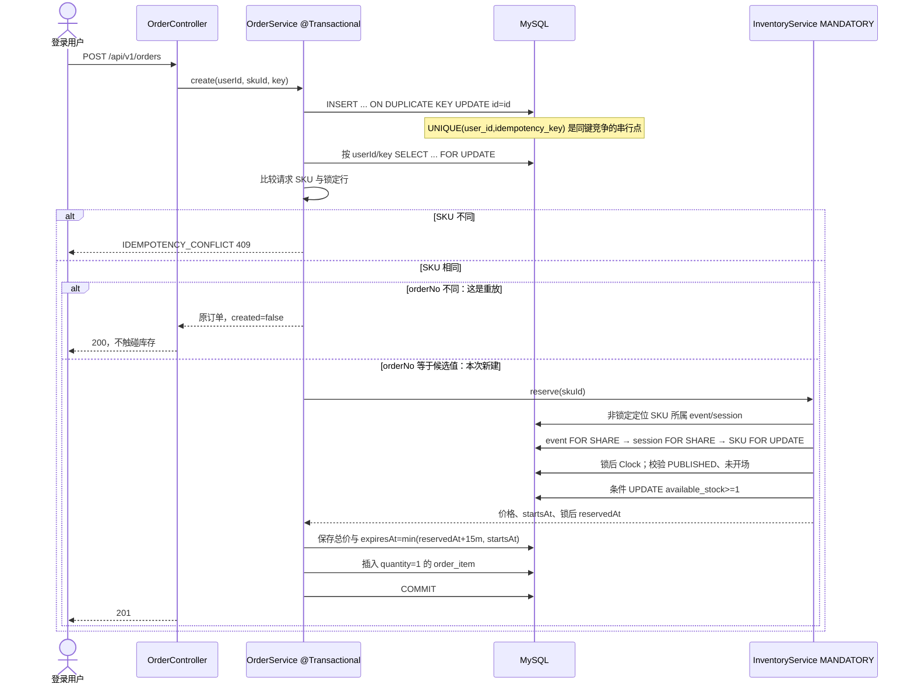
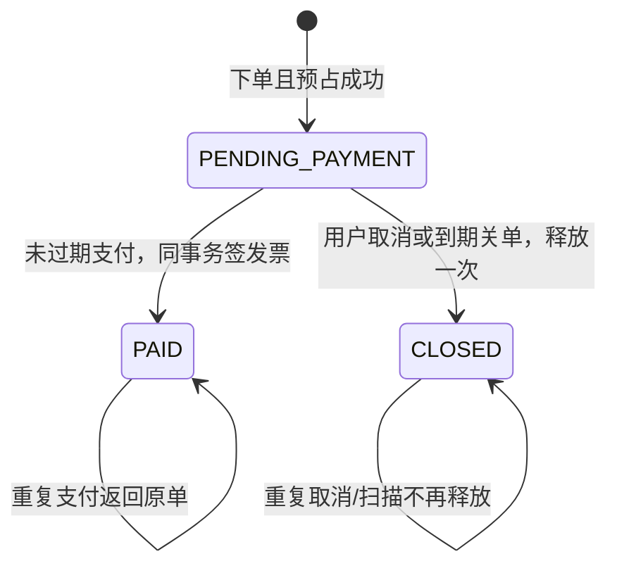
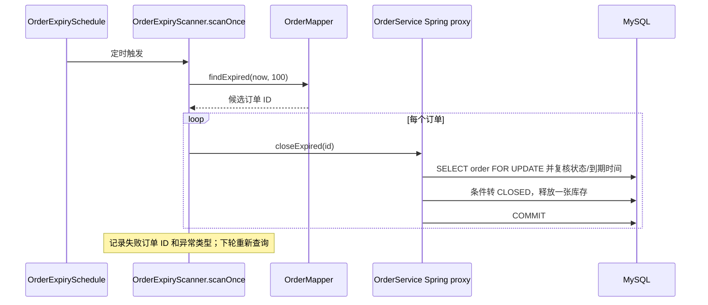
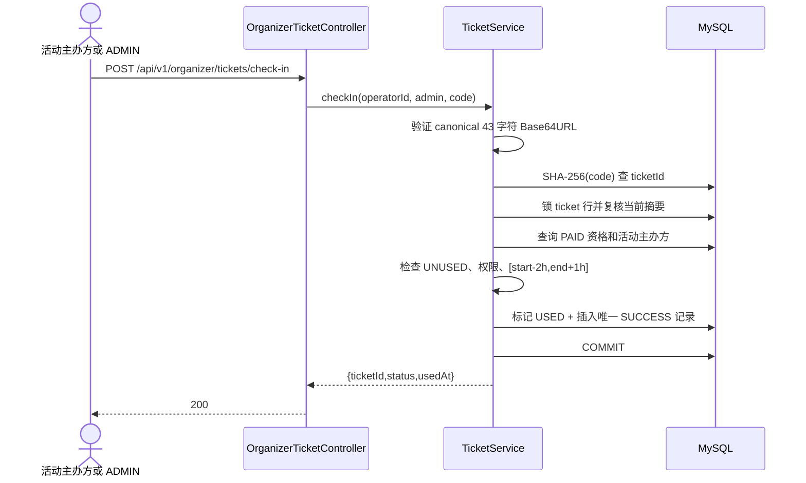

# Stage 2 关键调用链与状态图

本文解释幂等下单、终态竞争、到期补偿和票据核销。图表达事务边界与数据库不变量，不代表性能结论；实际构建和测试结果以 [Stage 2 handoff](../handoffs/stage-2.md) 为准。

## 1. 幂等下单与库存预占

HTTP 入口是 `OrderController.create`，从认证主体提取用户 ID 后调用 `OrderService.create`。Service 开启订单事务；event 模块的 `InventoryService.reserve` 以 `MANDATORY` 传播加入该事务。Controller 按 `CreateResult.created` 返回首次请求 201 或重放 200。

同键占位依靠数据库唯一约束与候选 UUID orderNo 区分首次事务和重放，不采用先查询再插入。第一次处理失败时占位、库存和明细一起回滚，键可以重试；CLOSED 订单重放仍返回旧单，不会再扣库存。`orders.requested_sku_id` 不设 SKU 外键，避免占位插入过早取得 SKU 外键共享锁后再升级为排它锁；实际成交关系由 `order_items.sku_id` 外键保护。

库存锁序为非锁定定位、event 共享锁、session 共享锁、SKU 排它锁。锁后重新读取 `Clock`、校验活动状态和场次时间，再通过 `available_stock >= 1` 条件更新扣减。父记录共享锁允许不同 SKU 的预订并行，同时与 Stage 1 编辑/发布的父行排它锁序列化。

## 2. 订单终态与支付/关单竞争

订单状态只从待付款进入一个不可逆终态：

支付、取消和到期关单先锁同一订单行，再按当前状态做条件更新。支付先提交时，关单方读取 PAID，不释放库存；关闭先提交时，支付方读取 CLOSED 并返回 409。支付和签票共用事务，关单和库存释放共用事务；任一步失败都回滚本次数据库写入。过期支付只返回 409，不顺带关单。

订单列表、详情、支付和取消均以认证主体 ID 限定本人订单；ADMIN 也不能跨所有权操作。纯 ORGANIZER 不能下单。角色与状态码见 [API 契约 §5](../02-domain-and-api-contract.md#52-认证所有权与-api)。
## 3. 到期扫描与逐单补偿

`OrderExpirySchedule` 每 30 秒触发 `OrderExpiryScanner.scanOnce()`。扫描器通过 `(status,expires_at,id)` 索引最多查询 100 个到期候选，并经 Spring 代理逐单调用 `OrderService.closeExpired`，使每笔关单各自在独立事务内完成：

批次不共享一个事务，因此单笔失败不会撤销其他已完成订单。代理调用让 `@Transactional` 生效，避免同类 `this.closeExpired()` 自调用绕过代理。失败订单仍保留为待付款持久状态，下轮可重试；设置 `app.orders.expiry-scan-enabled=false` 可禁用调度。

## 4. 电子票、码轮换与核销

订单支付调用 `TicketService.issue`，使用 `MANDATORY` 参与支付事务；order item 唯一约束保证一条明细最多签一张票。`GET /api/v1/me/tickets` 只返回当前用户拥有且订单已 PAID 的票。

票主调用 `MyTicketController.rotateCode` 时，Service 锁票行并校验所有权、PAID、UNUSED，然后生成 256 bit 随机值。核销码编码为 43 字符的无填充 Base64URL；数据库只保存 SHA-256 十六进制摘要，明文只通过 `{ticketId,checkinCode}` 响应一次。

核销从 `OrganizerTicketController.checkIn` 进入 `TicketService.checkIn`：

锁后复核摘要确保核销等待行锁期间若码已轮换，旧码返回 404。并发核销通过票行锁串行化，后续请求看到 USED 并返回 `TICKET_CONFLICT` 409。格式不规范为 400；格式合法但未知/旧码、或主办方跨活动核销为 404；未支付、已使用或超出含边界时间窗为 409。只有成功核销写 SUCCESS 记录，失败不落表。ADMIN 可跨主办方核销；USER 为 403。本人票据列表及码轮换始终按票主过滤。
## 源码阅读路径

- 下单、订单查询/支付/取消：[OrderController.java](../../backend/src/main/java/com/eventflow/order/web/OrderController.java)、[OrderDtos.java](../../backend/src/main/java/com/eventflow/order/web/OrderDtos.java)、[OrderService.java](../../backend/src/main/java/com/eventflow/order/application/OrderService.java)、[OrderMapper.java](../../backend/src/main/java/com/eventflow/order/infrastructure/OrderMapper.java)、`backend/src/main/resources/mapper/order/OrderMapper.xml`。
- 库存跨模块公开服务：[InventoryService.java](../../backend/src/main/java/com/eventflow/event/application/InventoryService.java)、[InventoryMapper.java](../../backend/src/main/java/com/eventflow/event/infrastructure/InventoryMapper.java)、`backend/src/main/resources/mapper/event/InventoryMapper.xml`。订单模块只依赖 event application service，不直接调用其 Mapper。
- 到期补偿：[OrderExpiryScanner.java](../../backend/src/main/java/com/eventflow/order/application/OrderExpiryScanner.java)、[OrderExpirySchedule.java](../../backend/src/main/java/com/eventflow/order/application/OrderExpirySchedule.java)。
- 票据和核销：[MyTicketController.java](../../backend/src/main/java/com/eventflow/ticket/web/MyTicketController.java)、[OrganizerTicketController.java](../../backend/src/main/java/com/eventflow/ticket/web/OrganizerTicketController.java)、[TicketDtos.java](../../backend/src/main/java/com/eventflow/ticket/web/TicketDtos.java)、[TicketService.java](../../backend/src/main/java/com/eventflow/ticket/application/TicketService.java)、[TicketMapper.java](../../backend/src/main/java/com/eventflow/ticket/infrastructure/TicketMapper.java)。
- 票据联查投影与资格：[TicketProjection.java](../../backend/src/main/java/com/eventflow/ticket/infrastructure/TicketProjection.java)、[TicketQualification.java](../../backend/src/main/java/com/eventflow/ticket/infrastructure/TicketQualification.java)，SQL 在 `backend/src/main/resources/mapper/ticket/TicketMapper.xml`。
- 数据库约束：[V2__orders_and_tickets.sql](../../backend/src/main/resources/db/migration/V2__orders_and_tickets.sql)；设计理由见 [ADR 0002](../decisions/0002-stage-2-order-consistency.md)。