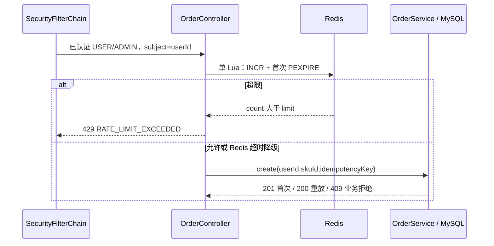
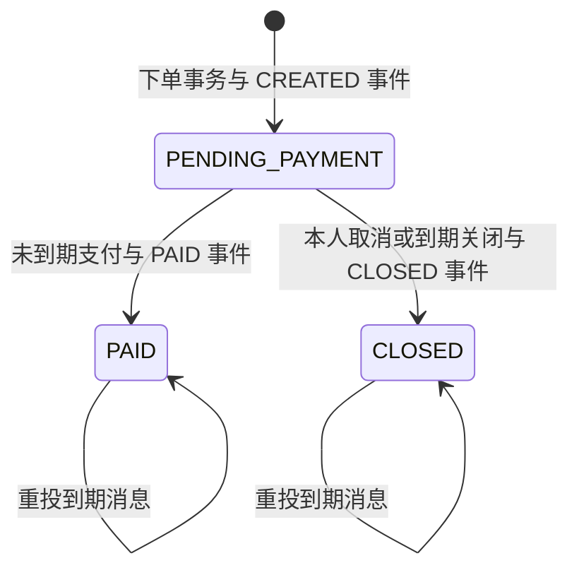

# Stage 3 关键调用链

先读 [ADR 0003](../decisions/0003-stage-3-reliability.md)，再对照下面的入口和测试。真实执行结果在 [Stage 3 交接](../handoffs/stage-3.md)，本页解释代码，不代替测试证据。

## 1. 目录读缓存，库存读数据库

`EventController` → 公开目录查询服务 → Redis：命中取得稳定元数据；未命中调用 `EventService` 的公开查询，成功后按 generation 校验回填。详情缓存结构没有 `availableStock`；返回前批量查询 SKU 当前库存，构造原有 `EventResponse`。Controller 不读 Mapper，缓存也不参与订单扣减。

发布事务持有原有活动锁，提交后才推进 Redis generation。并发回填必须比较读取时的代数：若发布已推进代数，旧查询不能把旧目录写成新代数据。不存在和草稿不缓存，404 不会因发布前的负键延迟转为可见。Redis 停机期间仍查询 MySQL；恢复后继续 Cache Aside，列表最长陈旧窗口由 TTL 加抖动限制。

学习时检查两处边界：缓存里是否出现 `availableStock` 字段；发布失败时有没有提前失效/泄露草稿。测试还应先读详情使缓存变热，再下单，确认下一次详情立即显示新的 MySQL 库存。

## 2. Lua 固定窗口按认证主体计数

请求 JSON 无法指定限流用户。固定窗口计数包含幂等重放和最终业务失败，避免靠不断重放绕开请求流量限制。窗口边界允许相邻两个窗口出现短时突发，这是算法的明确边界；它不是排队器或业务库存锁。测试并发使用同一认证用户，检查恰好规定数量通过、其余返回结构化 429，并检查其他用户和 TTL 复原。

## 3. 一次业务提交对应一次状态事件

`OrderService.create/pay/closeLocked` → `OutboxRecorder.record`（MANDATORY）→ MyBatis INSERT。订单、明细、库存、票据及 Outbox 使用同一个 MySQL 事务。重放 create、重复 pay/cancel、扫描终态都在原有条件处提前返回，因此没有伪事件。

`OutboxPublisher.publishBatchOnce` → 短事务认领一条 → RabbitTemplate 持久发送 → 等 correlated confirm 并检查 return → 短事务按 lease owner 标记 SENT。认领事务结束后才进行网络 I/O；多 publisher 不共享进程锁，而由 DB 的 claim/lease 协调。进程在发送后崩溃时事件会重发，消费者必须按业务效果幂等。

故障演练观察 `outbox_events.status/attempts/next_attempt_at/lease_until`，不要输出 payload 或应用凭据。MQ 断开时 HTTP 下单仍提交 PENDING 事件；恢复后再次发布。解绑路由时 broker 即使 confirm ack，也会 mandatory return，不能标 SENT。

## 4. TTL/DLX 触发不决定终态

创建事件按 `expiresAt - now` 设置消息 TTL，延迟队列经 DLX 转给到期消费者。消费者读取 canonical 事件，再调用 `OrderService.closeExpired`。数据库先锁订单并重新读可信 Clock；只有 PENDING_PAYMENT 且已到期才关闭。早到无副作用，已支付、已关闭、晚到和重复事件都不能再次释放库存。

混合 TTL 消息可能在队头等待，网络、调度和消费失败也会延迟，因此独立 scanner 保留。它不持有整批事务；通过注入的 OrderService 代理逐单执行。毒单关闭失败已回滚后，另一个 `OrderExpiryRetryService` 代理用 REQUIRES_NEW 写 retryAt，下一批便能越过它。101+ 订单测试应检查健康单推进和毒单 attempts 未在退避期持续增长。

## 5. 通知事务先提交，后确认消息

消息正文仅事件 UUID。handler 加载 Outbox canonical JSON，确认 eventId、聚合、事件类型与必要字段，再由通知用例按 eventId 唯一插入本人通知及消费记录。方法经 Spring 事务代理返回后，监听器才 basicAck。事务失败不 ack 成功，有限次重试通过 retry TTL 队列，最终落入 DLQ；提交成功但 ack 丢失的重投会命中 DB 唯一约束，不新增第二条通知。

`GET /api/v1/me/notifications` → 当前主体 ID → `NotificationService` → SQL `WHERE user_id = ? ORDER BY id DESC LIMIT ? OFFSET ?`。接口没有任意用户 ID 参数，ADMIN 也只读取本人。返回公开 DTO，不暴露 Outbox payload、核销码、密码或 JWT。

DLQ 不是删除队列。先定位根因和修复数据/代码，再按 README 的单条、确认重发流程重驱动；重复投递仍由持久唯一约束保护。不要使用 `requeue=true` 的忙循环掩盖毒消息，也不要因为日志打印了“收到”就断言业务已提交。

## 6. 验证入口

运行 `backend` 下的 Maven Wrapper `spotless:check verify`，会执行原 Stage 1/2 回归和 Stage 3 真实 MySQL/Redis/RabbitMQ 集成测试。测试凭据随机生成且仅在内存，使用动态端口，不依赖本机开发 Compose。Docker 不可用会失败，不会跳过 Gate。

CI 上传 Surefire、原 1000 请求并发结果与 `stage-3-fault-results.json`。学习时把失败注入、业务断言、持久状态和恢复动作一起看，单个 HTTP 200 或一条 MQ confirm 都不能单独证明整条链正确。
